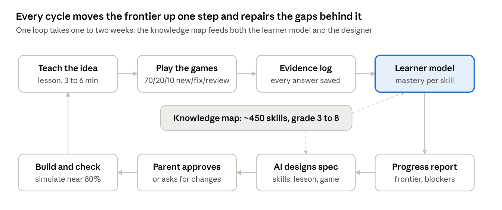
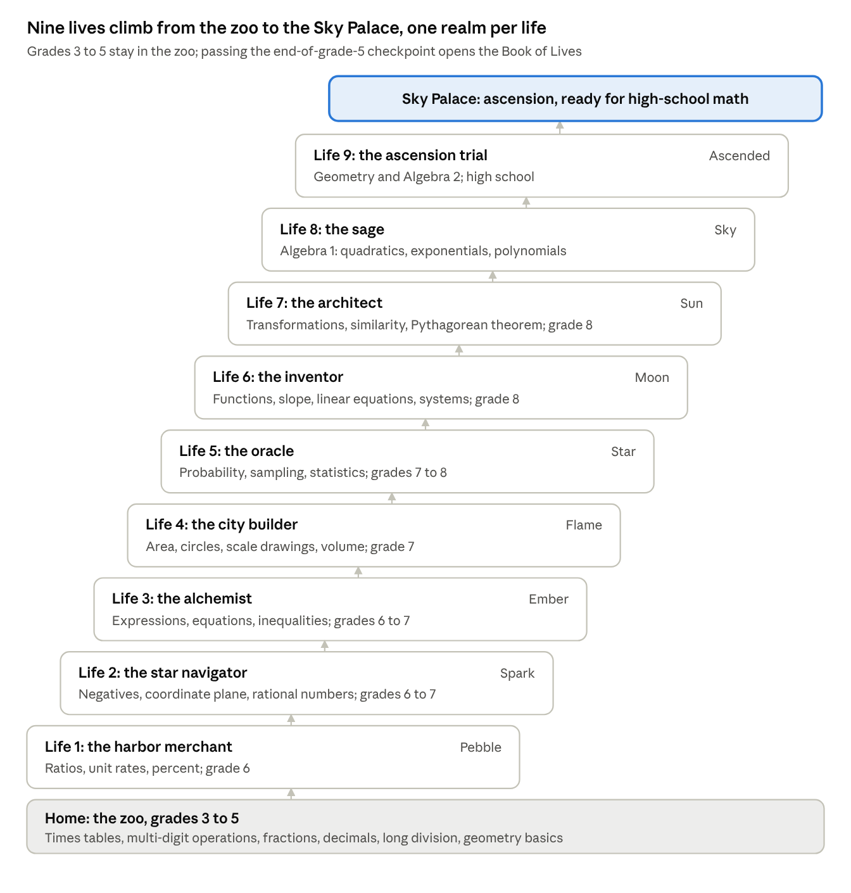
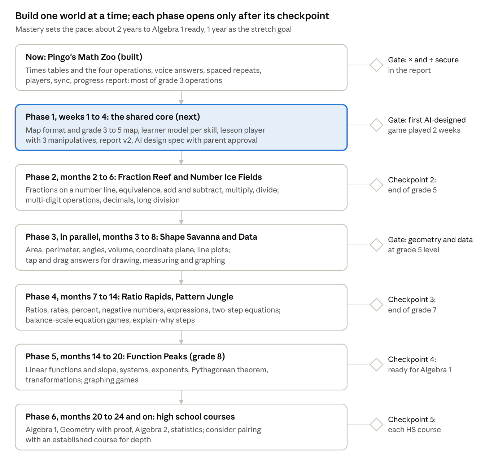

# Math Path: Grade 3 to High School — System Plan

Exported from the Claude Doc "Math Path: Grade 3 to High School — System Plan" on 2026-11-02. The doc is the editable original; this copy is for building from.

## Goal and the core loop

The goal is to take one child from third-grade arithmetic to readiness for high-school algebra and geometry, one small skill at a time, with a game they want to come back to. The system is not a single game: it is a map of math knowledge, a model of what the child knows on that map, and a steady stream of short games and lessons chosen from the gap between the two.

Every cycle runs the same loop:

1. **Play.** The child plays the current game (today: Pingo's Math Zoo).
2. **Report.** The game writes a progress report: what is solid, what is shaky, what errors the child makes, and how fast they are improving.
3. **Diagnose.** The report is placed on the knowledge map: which skills are mastered, which are on the frontier (all prerequisites known, skill itself not yet), and which weaknesses block the next step.
4. **Teach.** New ideas are taught before they are drilled: a short visual explanation, worked examples, then guided tries.
5. **Design the next game.** An AI (with a parent reviewing) picks the next game from a library of templates: about 70% frontier skills one step up, 20% repair of weak prerequisites, 10% spaced review of old skills.
6. **Repeat**, with the report from the new game closing the loop.

What success looks like:

- The child covers grade 3 through grade 8 (ready for Algebra 1) in about two years, with one year as the stretch goal, which is roughly three grade levels a year, without gaps piling up behind them. The grade labels describe the material, not the calendar: mastery sets the pace.
- Mastered skills stay mastered: they are retested weeks later and still answered correctly and quickly.
- The child can explain why an answer is right, not only produce it.
- They choose to play: 15 to 25 minutes a day, most days, without being pushed.

## What to learn from other platforms and from research

The strongest systems share three ideas: a map of prerequisites, a model of what each learner knows on that map, and spaced review so skills don't fade. Our plan copies those and adds what a family project can do better: teaching tuned to one child, and an AI that designs the next game from evidence.

| Platform | What it does well | What we take |
| --- | --- | --- |
| [Math Academy](https://mathacademy.com/how-our-ai-works) | Knowledge graph of thousands of topics (about 300 per course, grade 4 to university); adaptive diagnostic finds the "knowledge frontier" with an order of magnitude fewer questions; spaced repetition that credits review of a skill when a harder skill uses it ("FIRe"); quiz difficulty tuned so the average score is about 80% | The graph, the frontier, review credit flowing down to component skills, \~80% success as the target difficulty |
| [ALEKS](https://www.mheducation.com/content/dam/mhe/research/prek-12/essa-tier-4/aleks-assessing-learning-space.pdf) | Knowledge space theory: a learner's state is the set of items they can do; "ready to learn" = items whose prerequisites are all in that set | The definition of the frontier and the "ready to learn" list |
| [Khan Academy](https://support.khanacademy.org/hc/en-us/articles/115002552631) | Simple mastery levels per skill (Familiar 50, Proficient 80, Mastered 100 points); quizzes and unit tests can move skills up or down | A small, visible scale per skill that children and parents understand |
| [IXL](https://blog.ixl.com/2021/01/28/common-questions-about-the-ixl-real-time-diagnostic/) | Diagnostic gives a working grade level per strand (400 = ready for 4th-grade skills, 450 = halfway through) and an action plan; 10 to 15 questions a week keep it current | Report levels per strand in grade units; light, continuous re-checking instead of big tests |
| [Beast Academy](https://artofproblemsolving.com/wiki/index.php/Beast_Academy) | Grades 2 to 5 taught through comic stories with characters, then puzzle-rich practice; deeper problem solving than standard curricula | Story-led teaching, puzzles as "boss levels", depth over speed for strong kids |
| [DreamBox](https://www.discoveryeducation.com/programs/math/techbook/) | Virtual manipulatives; adapts within a lesson to the strategy the child uses, with scaffolds after a miss | Teach with interactive objects (fraction bars, number lines, area models), not only symbols |
| [Prodigy](https://fairplayforkids.org/?p=26304) | Very engaging RPG wrapper | A warning: critics counted far more game and upsell time than math in a session. Rewards must never outweigh the math or be paywalled |

What learning science adds, with the strength of evidence:

- **Space practice over time and quiz to re-expose key content**: moderate and strong evidence in the US Institute of Education Sciences practice guide ([IES 2007](https://ies.ed.gov/ncee/WWC/Docs/PracticeGuide/20072004.pdf)). Our Leitner-box repeats already do this.
- **Alternate worked examples with problems; combine pictures with words; link concrete and abstract**: moderate evidence (same guide). This shapes the teaching layer.
- **Ask deep explanatory questions** ("why does 7 × 8 = 7 × 7 + 7?"): strong evidence (same guide). Games should include explain-it moments, not only fast answers.
- **Concrete → pictures → symbols (CRA)** works well for children who struggle ([Ebner et al. 2025 meta-analysis](https://scholars.uky.edu/en/publications/a-meta-analytic-review-of-the-concrete-representational-abstract-/)).
- **Fractions and division matter most for later math**: 5th-graders' knowledge of fractions and division predicted high-school algebra and overall achievement in US and UK samples, after controlling for IQ, family income and whole-number skills ([Siegler et al. 2012](https://www.cmu.edu/news/stories/archives/2012/june/june15_mathsuccess.html)). The plan spends extra time here.
- **Gamification helps, modestly**: a meta-analysis found small positive effects on learning (g = 0.49), motivation (0.36) and behavior (0.25); story ("game fiction") and mixing cooperation with competition helped most ([Sailer and Homner 2020](https://opus.bibliothek.uni-augsburg.de/opus4/frontdoor/index/index/docId/109056)). So the game wrapper earns its place, but the learning design does the heavy lifting.

## The knowledge map

The map is a graph of small skills (nodes) joined by prerequisite arrows, grouped into seven strands that run from grade 3 to high school. It follows the US Common Core: grades 3 to 5 cover OA, NBT, NF, MD and G; grades 6 to 7 cover RP, NS, EE, G and SP; grade 8 adds F; high school is organized as Number and Quantity, Algebra, Functions, Geometry, and Statistics and Probability ([standards](https://thecorestandards.org/Math/Content/)). The order inside each strand follows the standards writers' [progressions documents](https://archive.math.arizona.edu/ime/progressions/). Each strand becomes a "world" in the game.

| World (strand) | Grade 3 | Grade 4 | Grade 5 | Grade 6 | Grade 7 | Grade 8 | High school |
| --- | --- | --- | --- | --- | --- | --- | --- |
| Number Ice Fields (place value, multi-digit operations) | Round to 10 and 100; add and subtract within 1000 | Place value to 1,000,000; multi-digit add/subtract; 4-digit × 1-digit, 2-digit × 2-digit; divide with remainders | Decimals to thousandths; standard multiplication; 2-digit divisors; decimal operations | Fluent long division; decimal operations; GCF and LCM | – | – | – |
| Pattern Jungle (operations to algebra) | Times tables from memory; properties; two-step word problems | Factors, multiples, primes; multiplicative comparison | Expressions with parentheses; numerical patterns | Expressions with variables; one-step equations and inequalities | Two-step equations; linear expressions | Linear equations; systems; exponents; square roots; scientific notation | Algebra 1 (linear, quadratic, factoring, polynomials), then Algebra 2 |
| Fraction Reef (fractions to rational numbers) | Unit fractions; fractions on a number line; equivalence; compare | Equivalent fractions; add/subtract like denominators; mixed numbers; fraction × whole number; tenths and hundredths | Add/subtract unlike denominators; multiply and divide fractions | Divide fractions; negative numbers; absolute value | Add, subtract, multiply, divide negatives and rationals | Irrational numbers | Rational exponents; complex numbers |
| Ratio Rapids (ratios and proportions) | – | – | – | Ratios; unit rates; percent | Proportional relationships; percent problems; scale drawings | Slope as a rate (leads into functions) | – |
| Function Peaks (functions) | – | – | – | – | – | What a function is; linear functions; slope and intercept | Linear, exponential and quadratic models; trigonometric functions |
| Shape Savanna (measurement and geometry) | Area; perimeter; time; attributes of shapes | Angles; lines and symmetry; area and perimeter formulas; unit conversion | Volume; coordinate plane; classifying shapes | Area of triangles and polygons; surface area; volume | Scale drawings; circles; angle relationships | Transformations; congruence and similarity; Pythagorean theorem; volume of cones, cylinders, spheres | Proof; similarity; trigonometric ratios; circles; coordinate geometry |
| Data Observatory (data, statistics, probability) | Picture and bar graphs; line plots | Line plots with fractions | Line plots | Mean, median, variability; distributions | Sampling; probability | Scatter plots; bivariate data | Statistics and probability |

Planning numbers (estimates, to be refined while building): each grade has roughly 25 to 30 standards, and each standard splits into 3 to 5 game-sized skills, so grades 3 to 8 come to about 400 to 500 nodes. Every node records:

- **id, title, grade, world, standard code** (for example `4.NF.B.3c`, add mixed numbers);
- **prerequisites** (must be mastered first) and **components** (simpler skills it exercises, which get review credit when it is practiced, the way Math Academy credits component skills);
- **teaching assets** (a short visual lesson, worked examples, the manipulative to use);
- **game templates** that can practice it, and **mastery test** items (including one "explain why" item).

Five checkpoints act as boss levels, each a short mixed test across the map:

1. **End of grade 3**: times tables and division facts fluent (3.OA.C.7); fractions on a number line. Today's Pingo game covers most of the first half.
2. **End of grade 5**: fraction and decimal operations and long division. This checkpoint gets extra time, because fractions and division at this age predict later algebra ([Siegler et al. 2012](https://www.cmu.edu/news/stories/archives/2012/june/june15_mathsuccess.html)).
3. **End of grade 7**: rational-number operations, proportional reasoning, two-step equations.
4. **End of grade 8 (ready for Algebra 1)**: linear functions, systems, exponents, Pythagorean theorem.
5. **High school**: Algebra 1, Geometry, Algebra 2, with statistics woven in.

## The adaptive loop

The learner model is the center of the system: every answer updates it, and every decision about what comes next is read from it.

How each decision is made:

- **Placement.** A new world starts with a short adaptive diagnostic: jump ahead after fast correct answers, step back after misses (today's doubling staircase, applied across the map). It ends with three sets: mastered, frontier ("ready to learn": all prerequisites mastered), and not yet reachable.
- **Mastery rule.** A skill is mastered when it is right on 85% or more of recent tries, mostly within the time target, with one "explain why" item correct, and is still right on a review at least a week later. Until the delayed review, it counts as proficient, not mastered.
- **Choosing the next work.** About 70% frontier skills, 20% repair of weak prerequisites, 10% spaced review, with no more than two new ideas open at once and similar skills kept apart.
- **Spaced review.** Each mastered skill comes back after growing gaps (for example 1 day, 3, 7, 21, 60). Practicing a harder skill counts as partial review of the simpler skills inside it, so review time doesn't grow as the map grows.
- **Blockers.** When errors in several frontier skills trace back to one prerequisite, that prerequisite returns to teaching, not just to drills.
- **Plateau.** When the report shows high accuracy and no new mastery for two weeks, the next design moves to a new world or a checkpoint instead of more of the same.

## The teaching layer

Every new skill is taught before it is drilled, in five short steps that take 3 to 6 minutes, and only then handed to the games. Drill without understanding produces the fast-but-fragile knowledge that breaks at the next grade; this layer is what turns the system from practice software into a tutor.

1. **Hook (30 seconds).** A small story moment in the world: "The penguins need to share 3 fish among 4 chicks." It names the problem the new idea solves.
2. **See it (1 to 2 minutes).** The idea shown with an object the child can move: fraction bars, a number line, an area model, base-ten blocks, a balance scale for equations. Pictures and spoken words together, then the symbols written under the picture (concrete → pictures → symbols).
3. **Worked examples (1 to 2 minutes).** Two or three solved examples, each with its steps labeled, then a "fading" example where the child fills in the last step, then the last two. Worked examples alternate with problems instead of coming in one block.
4. **Guided tries.** Three to five problems with hints on demand. Each hint is one step more specific than the last: a nudge ("what is 7 × 7?"), then the method, then the worked step. A wrong answer gets feedback on that specific error (the report's error categories, such as "neighbouring fact" or "forgot to borrow"), not just "try again".
5. **Explain it back.** One question asks why, not what: "Pingo says 1/3 is bigger than 1/2 because 3 is bigger than 2. Is he right?" The child answers by choosing or recording a short spoken explanation. Being asked to explain has strong evidence behind it, and it reveals misconceptions that right answers hide.

Rules that keep teaching honest:

- **One new idea at a time**, with no more than two new skills open in parallel, and similar-looking skills (for example × and ÷ of fractions) taught weeks apart so they don't interfere.
- **Teach to the misconception.** Each node lists its common misconceptions (for fractions: "bigger denominator means bigger fraction", "add the tops and add the bottoms"); lessons address them directly, and games include problems that expose them.
- **Reteach, don't repeat.** If a child fails the same skill twice, the system does not serve more of the same: it goes back to the prerequisite that the error points to, or switches representation (from symbols back to the manipulative).
- **Parent moments.** For each new world, a one-page guide for the parent: the big idea, two kitchen-table activities, and the questions to ask. A few minutes of adult conversation does what no game does.

## How the child answers

Voice is one option, not the default: each question uses the input that fits it, either a choice to tap or a typed answer, and any typed field also accepts dictation (Wispr on your devices, the system dictation key elsewhere). Every answer, including the child's own words, goes into the report.

| Input | Best for | How it is checked | What the report gets |
| --- | --- | --- | --- |
| Tap a choice (3 to 4 options) | New concepts, misconception probes, younger children, quick warm-ups | Instantly. Wrong options are built from known misconceptions, so the choice made tells us which one | The option picked and the misconception it signals |
| Choice plus "why?" | Checking understanding, not just recognition | Choice instantly; the explanation later by AI against a short rubric | The child's words, a rubric score, any misconception named |
| Typed answer (number, fraction, expression) | Procedures and anything where guessing must be ruled out | Instantly by code, including equivalent forms (2/4 = 1/2 unless simplest form is asked) | Exact answer given and error type |
| Free text, typed or dictated | Word problems, "explain your thinking", "find Pingo's mistake" | Saved verbatim; numbers inside it checked by code; reasoning scored by AI after the session | Full text plus rubric score, for the next design step |
| Spoken answer (today's recognizer) | Fast fact drills only | Instantly, offline | As today |

Rules: a skill is never marked mastered on multiple choice alone (guessing alone gets 25 to 33%), so every mastery check includes typed or explained items. Free-text answers never block the game while waiting for scoring: the child moves on, and the AI score lands in the next report.

## Gamification and engagement

For grades 3 to 5, the zoo grows into a whole island that maps one-to-one onto the knowledge map (from grade 6, the story mode below takes over): each world is a region, each mastered skill builds something in it, and each checkpoint opens a new region. The game wrapper earns about a third of a standard deviation in motivation in the research; the rest has to come from good learning design, so rewards follow learning and never replace it.

**The meta-game (what carries across all games)**

- **Pingo's island.** Today's zoo is the first region. Number Ice Fields, Fraction Reef, Shape Savanna and the others open at checkpoints. Mastering a skill adds something visible to its region: an animal, a building, a bridge. The island is the child's map of what they know, so the progress report and the game are the same picture.
- **Stars and levels** come from correct answers, with extra stars for skills being learned and for reviews that came back right after weeks (the spaced reviews matter most, so they pay most).
- **Story arcs per world.** Each world has a small story that introduces its big idea (Fraction Reef: the penguins must share fish fairly). Story was one of the two elements that most improved results in the gamification meta-analysis.
- **Boss levels** are the checkpoints: a mixed challenge across the world, with a reward big enough to remember.

**Game types, matched to what is being learned**

| Kind of skill | Game type | Example |
| --- | --- | --- |
| Facts to memorize (times tables, number bonds) | Fast voice or tap answers with spaced repeats | Today's Pingo game |
| Concepts (fractions, place value, negative numbers) | Manipulate-and-build puzzles | Cut fish into equal parts to feed chicks; place fractions on an ice floe number line |
| Procedures (long division, equations) | Step-by-step builders that check each step | A balance-scale equation game where each move keeps both sides equal |
| Problem solving and modeling | Short story problems with a choice of strategy | Plan a zoo enclosure with a given perimeter and the biggest area |
| Spatial and geometry | Construction and transformation puzzles | Rotate and reflect pieces to fit a pen; build volumes with blocks |
| Data and probability | Collect-and-graph quests | Survey the animals, graph the results, predict the next arrival |
| Explaining | "Pingo got it wrong" challenges | Find and fix Pingo's mistake, then say why it was wrong |

**Engagement rules**

- **Session shape:** 15 to 20 minutes: a 2-minute warm-up of spaced reviews, the main game or lesson, and a short win at the end. A gentle stop after 25 minutes; streaks reward days played, not minutes.
- **Difficulty:** aim for about 80% correct, as Math Academy does for quizzes: hard enough to learn, easy enough to keep going.
- **Mistakes are safe.** Wrong answers never cost anything already earned; they only bring the fact back sooner.
- **No pay-to-win, no ads, no rewards unrelated to math**, and nothing that takes more time than the math itself (the main criticism of Prodigy).
- **Some social play:** a sibling or parent can join cooperative challenges or a friendly race against their own best time; the research found cooperation mixed with competition worked best.
- **Choice:** the child picks between two or three recommended games or worlds, so it feels like their island.

## Story mode: the Book of Lives

Grades 3 to 5 stay in the zoo; from grade 6 the game becomes a story with one hero, one goal and nine lives: the spirit of a young penguin wants to ascend to the Sky Palace at the top of Frost Mountain, and the only way up is to master the Way of Numbers, one life at a time. The structure comes from the web novel 《凡人百世书》 by 白眉罗汉 ([红袖读书](https://www.hongxiu.com/novelbaike/1pcbn19zsewlm)): a commoner whose soul carries a Book of a Hundred Lives is reborn into his own descendants, the book tallies each life when it ends, and over nine lives he cultivates toward ascension. Our story borrows only that structure; the world, characters and plot are original.

Why it fits the learning loop:

- **One goal holds everything together.** Ascension means reaching high-school math: Algebra 1 ready, then a final trial. Every life is a step toward the same summit, so there is always a clear "next level".
- **The settlement is the progress report.** When a life ends (a world's checkpoint), the Book shows its page: days lived (sessions played), constitution (accuracy and speed), talents (strengths), skills learned (mastered skills), deeds (achievements), and a rating (Ordinary, Fine, Rare, Epic, Legendary). The parent's full report sits behind the same data.
- **Inheritance gives choice.** Mastered math always carries over as memories. On top of that, the child picks one gift to inherit, for example a talent ("number-line sight": a number-line hint is always available), a tool (fraction bars), or a companion. Gifts improve as the realm rises.
- **Realms mark the checkpoints.** A kid-friendly ladder of nine realms (Pebble, Spark, Ember, Flame, Star, Moon, Sun, Sky, Ascended) replaces grade numbers.
- **Generations, not deaths.** Each new life is the next generation of the same penguin family, which suits children better than dying. The zoo the child built in grades 3 to 5 becomes the family's ancestral home: graduating from it (the end-of-grade-5 checkpoint) opens the Book, and the home keeps growing across generations.
- **Failure still moves the story.** A failed trial ends the life early, but it still settles, still passes on a gift and still reveals a clue, the way the game Hades turns each failed run into story progress ([Game Developer](https://gamedeveloper.com/design/how-supergiant-weaves-narrative-rewards-into-i-hades-i-cycle-of-perpetual-death)). The next life retries with a different teaching approach.

**Presented as a story RPG, in the style of 仙剑奇侠传**

| Game element | What it does for learning |
| --- | --- |
| A main quest written in advance, chapter by chapter | Keeps one coherent story; the AI writes only side quests and settlement text tailored to the report |
| Towns with NPCs, dialogue boxes and character portraits | Each NPC request is a word problem or a lesson hook |
| Three or four companions who travel with the hero | Each embodies a strand and acts as its tutor (the harbor merchant teaches fractions); their dialogue delivers the teaching layer |
| Turn-based battles | Each move is a problem; mastered skills are spells; a multi-step problem is a combo; an enemy's weakness is the skill being targeted |
| Dungeon puzzles | Manipulatives: a bridge built from fraction bars, a door opened by balancing an equation |
| The boss of each life | The checkpoint |
| Save points | Sessions of 15 to 25 minutes: one town visit and one battle |

How the story gets written and drawn:

- **Series bible first.** The world map, the nine lives, the companions, the main mystery and each life's arc are written once and kept in the repo; each chapter's script is generated from the bible plus the latest report and reviewed by a parent.
- **Art direction.** Ink-wash landscapes with clean, expressive character portraits, the classic look of Chinese story RPGs, using animal characters so the cast stays original and kid-friendly. Each character gets a sheet with four to six expressions; each town gets one background.
- **Making the art.** The game engine (dialogue, portraits, battles, maps) can be built in the browser like today's game, but painted art needs either an image-generation tool working from a fixed style guide and reference sheets, or an illustrator. This environment cannot paint images; until the art exists, the game uses the current drawn style.
- **Cost.** This is the most expensive direction: a story RPG needs about 9 settings, 10 to 15 characters with expressions, and a written main quest. Keeping the zoo for grades 3 to 5 means this cost is needed only from about month 6, and the zoo remains the fallback if the story mode takes longer to build.

Each life covers one stretch of the knowledge map and ends with its checkpoint and settlement; at the planned pace a life lasts about two months, so the nine lives fit the roadmap's months 6 to 24.

## From report to next game

The AI never designs a new game from a blank page. The games, lessons and story are built once; after each report the AI writes a small **learning plan**, a file of parameters that the same games read. It picks skills from the map and sets how hard, how much help, the bar to pass, the question mix, the pace and the next story chapter. Code changes only when a plan needs a game template that does not exist yet. This keeps every cycle grounded in evidence, quick to produce and checkable by a script, and the results comparable from week to week.

**1. The report (extends the one Pingo produces today)**

- Learner: name, age or grade, sessions, time played, trend (improving, steady, plateaued).
- Per skill node: status (not started, learning, proficient, mastered, needs review), accuracy, speed, last practiced, error types with examples (what the child said instead).
- Per world: working grade level (IXL-style, for example "Fraction Reef 4.3") and the frontier: skills whose prerequisites are all mastered.
- Blockers: weak prerequisites behind several frontier skills (for example, "equivalent fractions" blocking all of fraction addition).
- Engagement: minutes per day, games chosen when given a choice, where the child quit.
- The child's own words: typed or dictated explanations and word-problem answers, with an AI rubric score and any misconception they show.
- A machine-readable JSON block, so the AI reads numbers rather than prose.

**2. The learning plan (a fixed prompt plus the report)**

The AI returns one JSON file in a fixed format (`schema/learning-plan.schema.json` in the repo). Its main parts:

1. **Basis**: the skills the report shows as mastered or shaky, the misconceptions seen, and a short summary for the parent.
2. **Focus skills**: 2 to 6 skills by id, each with a role (new, repair, review or stretch), a weight and the evidence behind it.
3. **Per-skill settings**: the difficulty (starting and highest level, number size, denominators, regrouping, context), which templates and input types to use, the hint level, the misconceptions to target, and the **bar** that counts as done (accuracy, attempts, level, speed, a check a few days later).
4. **Session and pacing**: minutes, the new/repair/review mix (about 70/20/10 by default), how many new skills may open, fact-drill minutes, how often to ask "why?", and whether the child may test out of a skill.
5. **Story and rewards**: the chapter from the fixed story library, its character and goal, and what earns bonus stars this week.
6. **Checkpoint**: the short quiz at the end that produces the next report.

The mix shifts toward repair when blockers appear and toward the frontier when the trend says "plateaued at a high level".

**3. Check, review and run**

- A script checks the plan before the child sees it. It rejects unknown skills, a new skill whose prerequisites are not mastered, a template the skill does not support, a story chapter from another world, and a bar that can never be reached.
- A parent reads the plan in plain words on the parent screen and approves it or asks for another.
- The app runs the plan with no build. Before a new template is used for the first time, it runs against simulated learners to confirm the difficulty lands near 80% correct.
- Only when the plan lists a missing template does Claude Code build one, from the plan's short spec, following the template contract.

**4. Close the loop**

After one to two weeks, the next report is compared with the spec's success test. Skills that passed become mastered and enter spaced review; skills that failed go back to teaching with a different representation, and the AI is told what did not work.

## System architecture

The system splits into a shared core (map, learner model, scheduler, report) and many small games that plug into it. Pingo's Math Zoo already has early versions of most core parts; the work is to generalize them from "four operations" to "any node on the map".

| Part | What it does | In Pingo today | To build |
| --- | --- | --- | --- |
| Knowledge map | Nodes, prerequisites, components, standards codes, teaching assets, game templates per node | Four ladders (×, ÷, +, −) in `curriculum.js` | A map file per grade band (JSON), starting with grade 3 to 5 fractions and place value |
| Learner model | Per node: mastery estimate, evidence history, review schedule, error types | Edge estimate, Leitner boxes and answer history in `skillModel.js` and `players.js` | Same model keyed by node id; review credit flows to component skills |
| Placement | Finds the frontier quickly | Doubling staircase on one ladder | Adaptive diagnostic across the map ("ready to learn" sets) |
| Scheduler | Picks the next item: frontier, repair, review | Weighted mix with spaced repeats and probes | The same mix across nodes and games, honoring "one new idea at a time" |
| Teaching player | Runs lessons: hook, manipulative, worked examples, hints, explain-back | Review screen after a miss only | Lesson format and player, plus a manipulatives kit (fraction bars, number line, area model, balance) |
| Game templates | Reusable game engines fed by node and question settings | One fact-drill game with voice answers | 5 to 7 templates matching the game-type table; answer input by voice, tap or drag |
| Answer checking | Recognizes answers reliably | Offline number recognizer and fuzzy matcher (1 to 81) | Choice, keypad and free-text input (typed or dictated with Wispr); equivalence checks for fractions and expressions; AI scoring of explanations after the session |
| Report | Strengths, weaknesses, levels, errors, trend, JSON | Per-child report for the four operations | Per-world grade levels, frontier, blockers, engagement |
| Design pipeline | Report → AI spec → parent approval → build → simulate | Manual (this conversation) | Fixed prompt, spec format, question generator with computed answers; reports saved in the repo for Claude Code to build from |
| Accounts and sync | Players, Google sign-in, cloud copy | Players, backup file, Firebase sync (pending setup) | Unchanged; the stored data grows to the whole map |
| Island (meta-game) | Visible progress across worlds | The zoo | Regions per world, building per mastered skill |

Data model, in brief:

- **Node**: `{ id, title, world, grade, standard, prerequisites[], components[], misconceptions[], lesson, templates[], masteryTest }`.
- **Evidence**: one record per answer: time, node id, item, correct, time taken, what was said or entered, hint level used.
- **Learner state per node**: mastery (0 to 1), status, next review date, error counts. Recomputed from evidence, so the model can be improved later without losing history.

Privacy: children's data stays on the family's devices and in the family's own Firebase project; reports go to an AI only when a parent sends them, and they contain no full name or school.

## Roadmap, step by step

Build the shared core next, then add one world at a time, and open each new phase only when the child passes its checkpoint. The child's progress sets the pace, not the build schedule.

The next concrete steps (Phase 1), in order:

1. **Map format and the first slice of the map.** Write the node format and fill it for grade 3 to 5 fractions and place value (about 60 nodes), with prerequisites and misconceptions. Move today's four ladders into it.
2. **Learner model per node.** Generalize today's mastery, spaced repeats and answer history from four ladders to any node, keeping the existing children's progress.
3. **Lesson player and three manipulatives.** Fraction bars, a number line and an area model, with the five-step lesson format and hints, plus the new answer inputs: tap a choice, keypad, and free text that works with Wispr or typing.
4. **Report v2.** Add per-world grade levels, the frontier, blockers and engagement to today's report.
5. **Design pipeline v1.** A fixed prompt, the spec format, a question generator whose answers are computed by code, and a parent approval screen.
6. **First AI-designed game.** Feed the current report through the pipeline, build the game it specifies (likely fractions on a number line), and run it for two weeks. Its report is the first full turn of the loop.

Each later phase repeats one pattern: write the world's slice of the map, build its two or three games and lessons, run it with the child, and use the checkpoint to decide whether to move on or repair.

How the timeline stays short (about two years from grade 3 to ready for Algebra 1, one year as the stretch goal):

- **Skip what is known.** Placement inside each world jumps past mastered skills, as today's staircase does, so time goes only to real gaps.
- **Run worlds in parallel.** Worlds whose prerequisites are met run side by side (Shape Savanna alongside Fraction Reef; Data Observatory alongside both), with about 70% of time on the main world.
- **Follow the spine.** The skills that feed algebra (fractions, negative numbers, expressions, equations, linear functions) get priority; side topics (some measurement and data skills) are covered more lightly and picked up inside later worlds.
- **Try checkpoints early.** A child who feels ready can attempt a checkpoint at any time; passing it opens the next world immediately.
- **Build ahead of the child.** Each world's games are built while the child is still in the previous one, so the child never waits for the build.

## Measuring success, risks and open questions

Success is measured by retention and transfer, not by stars: a skill counts only if it is still right weeks later and works inside harder problems.

| Measure | Target | Checked by |
| --- | --- | --- |
| Pace | About 3 grade levels of skills a year (grade 3 to Algebra 1 ready in about 2 years; 1 year is the stretch goal) | Working grade level in each report |
| Retention | 85% or more on spaced reviews 2 to 4 weeks after mastery | Review results in the evidence log |
| Transfer | Mastered prerequisites hold up when used inside new skills | Errors in new skills traced back to prerequisites |
| Understanding | Most "explain why" items answered well | Explain-back responses, spot-checked by a parent |
| Engagement | 15 to 25 minutes on most days, chosen freely | Session log |
| Outside check | School grades and teacher feedback agree with the report | Parent, each term |

Risks and how the plan handles them:

- **Speed without understanding.** Fluency games can hide gaps. Every node has explain-why items, and a fast but unexplained skill is not marked mastered.
- **AI mistakes in content.** Every generated answer is computed by code, every new game is simulated before the child sees it, and a parent approves every spec.
- **Voice recognition errors read as math errors.** Reports flag likely recognition errors (such as teen/-ty swaps), and later worlds add tap and drag answers.
- **Too much screen time or reward-chasing.** Daily caps, no unrelated rewards, offline parent activities per world.
- **Building too much at once.** One world at a time, each released only when the previous one works with the child (see the roadmap).

Open questions:

- Which curriculum the child's school follows, so the map's order matches class timing (Common Core is the default here).
- Whether there are other learners to plan for (siblings) and how different their starting points are.
- How much parent time per week is realistic for reviewing specs and the offline activities.

## Sources

- [Math Academy: how our AI works](https://mathacademy.com/how-our-ai-works) and [pedagogy](https://mathacademy.com/pedagogy)
- [ALEKS: assessing the learning space (McGraw Hill)](https://www.mheducation.com/content/dam/mhe/research/prek-12/essa-tier-4/aleks-assessing-learning-space.pdf)
- [Khan Academy: course and unit mastery](https://support.khanacademy.org/hc/en-us/articles/115002552631)
- [IXL: common questions about the Real-Time Diagnostic](https://blog.ixl.com/2021/01/28/common-questions-about-the-ixl-real-time-diagnostic/)
- [Beast Academy (Art of Problem Solving wiki)](https://artofproblemsolving.com/wiki/index.php/Beast_Academy)
- [DreamBox Math (Discovery Education)](https://www.discoveryeducation.com/programs/math/techbook/)
- [Fairplay: concerns about Prodigy](https://fairplayforkids.org/?p=26304) (an advocacy group's view)
- [IES practice guide: Organizing Instruction and Study to Improve Student Learning (2007)](https://ies.ed.gov/ncee/WWC/Docs/PracticeGuide/20072004.pdf)
- [Ebner et al. (2025), meta-analysis of the concrete-representational-abstract approach](https://scholars.uky.edu/en/publications/a-meta-analytic-review-of-the-concrete-representational-abstract-/)
- [Siegler et al. (2012), fractions and division predict high-school math (Carnegie Mellon summary)](https://www.cmu.edu/news/stories/archives/2012/june/june15_mathsuccess.html)
- [Sailer and Homner (2020), The gamification of learning: a meta-analysis](https://opus.bibliothek.uni-augsburg.de/opus4/frontdoor/index/index/docId/109056)
- [Common Core State Standards for Mathematics](https://thecorestandards.org/Math/Content/) and [Progressions documents](https://archive.math.arizona.edu/ime/progressions/)
